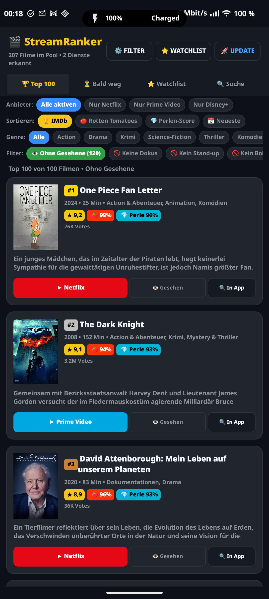
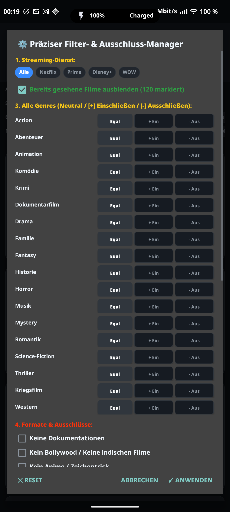
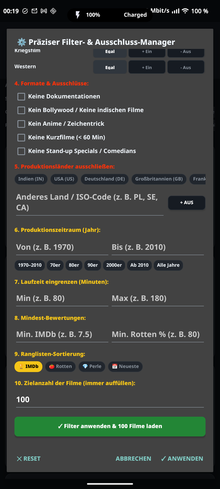

# StreamRanker 🎬

[](https://android.com)
[](LICENSE)
[](https://github.com/diggaknoxville/stream-ranker/releases)

**StreamRanker** ist eine native, blitzschnelle Android-App zur Entdeckung der besten Filme auf deinen Streaming-Diensten. Schluss mit den intransparenten Empfehlungsalgorithmen der Streaming-Giganten: StreamRanker liefert ein echtes, unvoreingenommenes Leaderboard sortiert nach **IMDb**, **Rotten Tomatoes** oder dem intelligenten **Perlen-Score**, mit direkter App-Anbindung und automatischem OTA-Update-Support.

---

## 📱 Screenshots

<p align="center">
  
  
  
</p>

---

## ✨ Features

### 1. 🏆 Unabhängiges Curation-Leaderboard
* **Multi-Score-System:**
  * **★ IMDb-Score:** Echte Publikumswertung inklusive Stimmenanzahl.
  * **🍅 Rotten Tomatoes:** Kritiker-Tomatometer (z. B. 94%, 99%).
  * **💎 Perlen-Score:** Gewichteter Kombinationsindex aus IMDb und Rotten Tomatoes zur Entdeckung echter filmischer Meisterwerke.
* **Sortier-Modi:** Wählbar nach IMDb, Rotten Tomatoes, Perlen-Score oder Produktionsjahr.

### 2. ⚙️ Präziser Filter- & Ausschluss-Manager
* **Genre-Dimension:** Alle 18 TMDB/Streaming-Genres einzeln auf *Neutral*, *[+] Einschließen* oder *[-] Ausschließen* konfigurierbar.
* **Ausschluss von Stand-up Specials:** Filtert Stand-up Comedy Programme und Comedians zuverlässig heraus.
* **Produktionsländer-Blacklist:**
  * Schnellauswahl für Indien (IN), USA (US), Deutschland (DE), Großbritannien (GB), Frankreich (FR), Japan (JP), Südkorea (KR), Spanien (ES), Italien (IT), Türkei (TR), China (CN).
  * Freitext-Eingabe für beliebige ISO-Ländercodes (z. B. `PL`, `SE`, `CA`, `DK`).
* **Format-Ausschlüsse:** Dokus, Bollywood, Anime/Zeichentrick, Kurzfilme (< 60 Min).
* **Produktionszeitraum:** Beliebige Jahre einstellbar (z. B. 1970 bis 2010) mit 1-Klick-Epochen-Presets.
* **Mindest-Bewertungen & Laufzeit:** Filter für IMDb-Schwellenwert, Rotten Tomatoes % und Min/Max-Minuten.

### 3. 👁️ Gesehen-Tracking & Listen-Ausschluss
* Markiere Filme mit einem Tippen als `👁️ Gesehen`.
* Schließe bereits gesehene Filme global per Chip oder Dialog aus der Vorschlagsliste aus.

### 4. 🚀 Automatisches Nachladen (100-Filme-Garantie)
* Bei aktiven Filtern lädt die App im Hintergrund vollautomatisch aus dem Live-Katalog nach, bis die gewünschte Zielanzahl (z. B. immer exakt **100 Filme**) erreicht ist.
* Beliebig erweiterbar über `[⬇ Weitere 50 Filme nachladen]`.

### 5. 🎯 1-Klick Wiedergabe & App-Launch
* Erkennt automatisch auf dem Smartphone installierte Streaming-Apps (Netflix, Amazon Prime Video, Disney+, WOW).
* Startet den ausgewählten Film direkt im installierten Streaming-Client über verifizierte Deep Links mit automatischem In-App Search Fallback.

### 6. 💾 Vollständige Einstellungs-Persistenz
* Alle Filterkriterien, ausgeschlossenen Länder, Stand-up Toggles, Sortier-Modi und Dienstauswahlen werden automatisch in `SharedPreferences` gespeichert und überstehen App-Neustarts.

### 7. 🔄 Integriertes Over-The-Air (OTA) Update
* Prüft beim Start im Hintergrund (und manuell über `🚀 Update`) via GitHub REST API auf neue Versionen unter `diggaknoxville/stream-ranker`.
* Zeigt Changelog-Dialog, lädt neue APKs direkt herunter und öffnet den Android Package Installer.

---

## 🛠️ Build & Entwicklung

StreamRanker benötigt kein schwerfälliges Gradle-Setup. Es kompiliert in unter 5 Sekunden direkt über das Android SDK:

```bash
# Repository klonen
git clone https://github.com/diggaknoxville/stream-ranker.git
cd stream-ranker

# Bauen & Signieren (erzeugt build/stream-ranker.apk)
./build.sh

# Auf angeschlossenem Android-Gerät installieren
adb install -r build/stream-ranker.apk
```

---

## 📄 Lizenz

Dieses Projekt steht unter der [MIT Lizenz](LICENSE).
